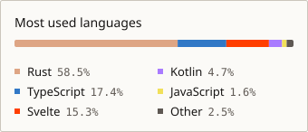

# Projects

| | App | Use |
|:-:|:--|:--|
|  | **[Ficelle](https://github.com/Synaelle/ficelle)** | Notes app |
|  | **[Noeud](https://github.com/Synaelle/noeud)** | Reminders API with apps |
|  | **[Baguette](https://github.com/Synaelle/baguette)** | FTP client |
|  | **[Cement](https://github.com/Synaelle/cement)** | 3DS FTP server |

<picture><source media="(prefers-color-scheme: dark)" srcset="assets/languages-dark.svg"></picture>
